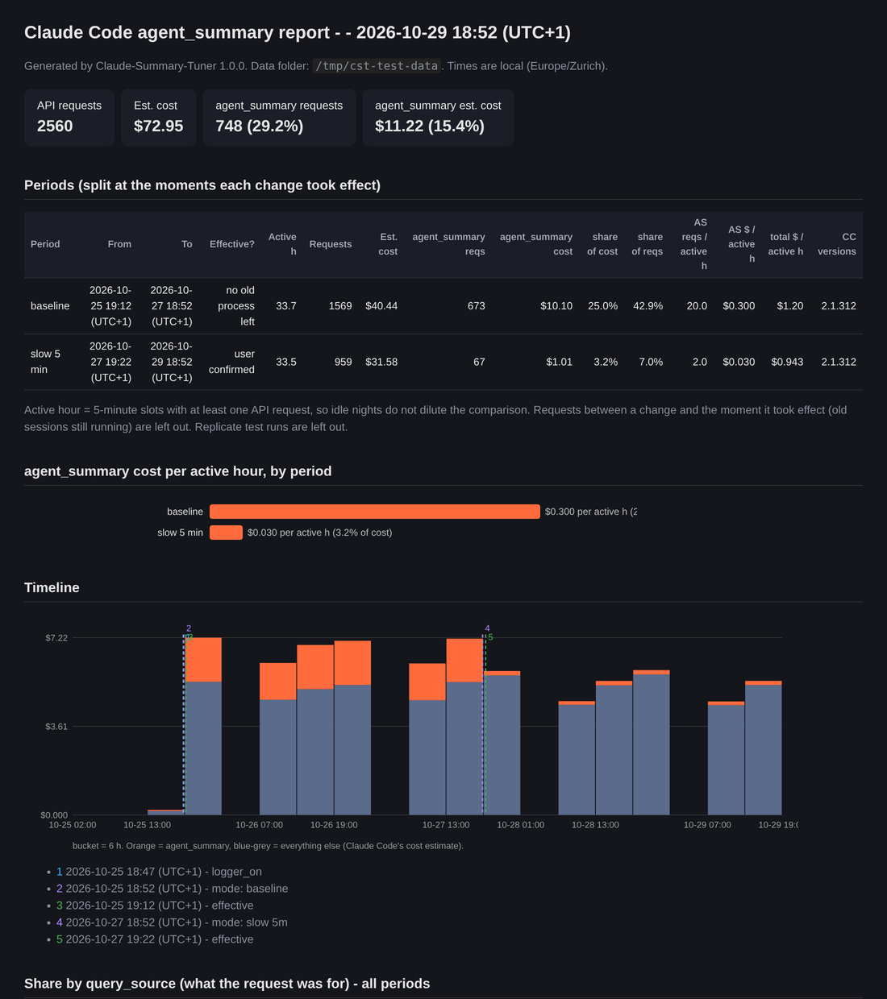
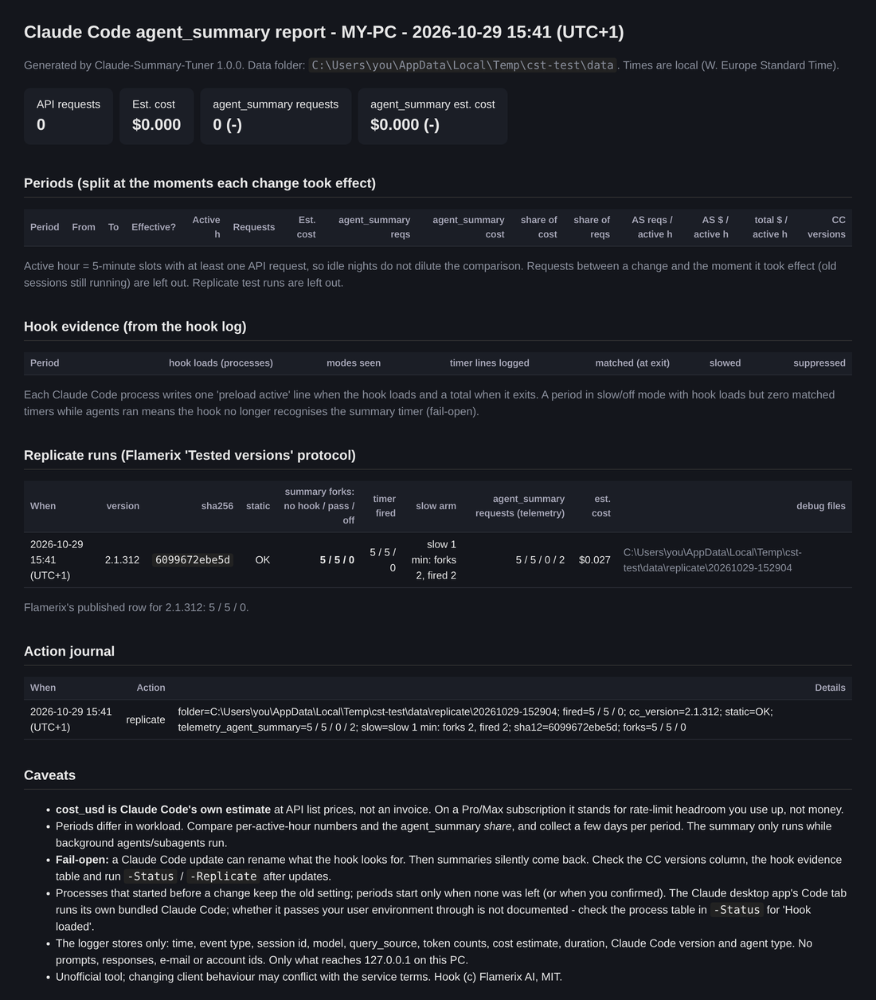
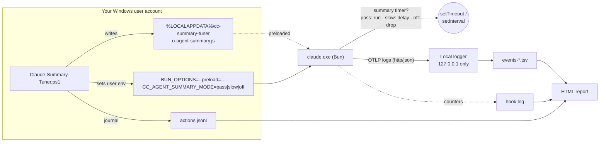

<div align="center">

# Claude Summary Tuner

### Claude Code re-sends each background agent's whole transcript every ~30 s, just to refresh a 3–5 word status line.<br>In Flamerix's measurement that was up to ~16% of spend (Anthropic says ~2% on average). Measure your own share on Windows, then slow it down or switch it off.

[](#quick-start)
[](#quick-start)
[](#replicate-the-flamerix-test)
[](#the-claude-desktop-app)
[](LICENSE)
[](https://github.com/omgapnt/claude-summary-tuner/releases/latest)
[](https://github.com/omgapnt/claude-summary-tuner/releases)

**One file · no admin · no Node · fully undoable · measure first, then change**

```powershell
irm https://github.com/omgapnt/claude-summary-tuner/releases/latest/download/Claude-Summary-Tuner.ps1 -OutFile Claude-Summary-Tuner.ps1
powershell -ExecutionPolicy Bypass -File .\Claude-Summary-Tuner.ps1
```

<sub>Windows port of <a href="https://gist.github.com/flamerix-ai/c3905705cc4205e5de3011fa2e74efce">Flamerix's <code>no-agent-summary.js</code></a>, whose path check never matches on Windows. If this saves you tokens, a ⭐ helps other Windows users find it.</sub>



<sub>The built-in HTML report. <b>The screenshot uses the synthetic test data from <code>test/unit.ps1</code></b>, not a real measurement. Your numbers come from your own usage.</sub>

</div>

---

## The problem in 30 seconds

- While a **subagent or background agent** runs, Claude Code (since v2.1.232) starts a side request about every
  **30 seconds**. The side request is tagged `query_source = agent_summary`.
- Each one sends that agent's **entire transcript** to the agent's model, often Opus, and asks for a
  *"3-5 word"* description. The answer only updates the status text in the agents panel.
- [Flamerix AI measured](https://gist.github.com/flamerix-ai/c3905705cc4205e5de3011fa2e74efce) these requests at
  **16.4 % of all Claude Code spend** over one week, which was more than their main conversation (15.7 %).
  [anthropics/claude-code#86879](https://github.com/anthropics/claude-code/issues/86879) collects other reports of
  18-26 %. Your share depends on how much you use agents.
- A Claude Code engineer [replied on Hacker News](https://news.ycombinator.com/item?id=50284255) that across users who
  send telemetry, `agent_summary` was about **2 % of cost** (about **6 %** in the terminal) the week before, that a fix
  for summaries missing the prompt cache shipped in **2.1.311+**, and that a cheaper mode is in the works. Heavy
  background-agent users are the ones who pay most, and measuring your own share is what this tool is for.
- There is **no setting** to turn it off. Flamerix published a small Bun `--preload` hook that does. It was
  tested on Linux and reported working on macOS, but **its gate never fires on Windows**. On Windows, Bun's
  `Bun.main` is `B:/~BUN/root/cli`, not `/$bunfs/root/cli`.

**This repo makes it work on Windows and adds a way to measure it.** It is one PowerShell script that:

| | |
|---|---|
| 🪟 **Windows support** | Ships Flamerix's hook with a Windows path gate, installed through the `BUN_OPTIONS` user variable |
| 🐢 **Slow mode** | Keeps the status line, but updates it at most every 5 minutes, or every N minutes you choose |
| 📈 **Local logger** | Records Claude Code's own OpenTelemetry `api_request` events by `query_source` on 127.0.0.1 |
| 🗒️ **Action journal** | Timestamps every change and the moment it *actually* took effect, once all old sessions are gone |
| 📊 **HTML report** | Compares before and after per active hour, with inline SVG charts and no internet needed |
| 🔬 **Replicate mode** | Re-runs Flamerix's A/B test on your machine for about $0.03 of Haiku |

## Quick start

In PowerShell (Windows PowerShell 5.1 or PowerShell 7, **no admin**):

```powershell
irm https://github.com/omgapnt/claude-summary-tuner/releases/latest/download/Claude-Summary-Tuner.ps1 -OutFile Claude-Summary-Tuner.ps1
powershell -ExecutionPolicy Bypass -File .\Claude-Summary-Tuner.ps1
```

Or download `Claude-Summary-Tuner.ps1` from the [latest release](https://github.com/omgapnt/claude-summary-tuner/releases/latest).
Want to check it first? See [Is this safe?](#is-this-safe) below. Pick an option from the menu (`Q` quits without
changing anything). Then **close and restart every Claude Code session** (see
[Restart everything](#-restart-everything-after-every-change)).

> **Running the other commands in this README:** they are written as `.\Claude-Summary-Tuner.ps1 -Status` and so on.
> Windows' default execution policy blocks unsigned scripts, and a file downloaded with a browser is blocked under
> `RemoteSigned` too. If you see "running scripts is disabled", put
> `powershell -ExecutionPolicy Bypass -File` in front: `powershell -ExecutionPolicy Bypass -File .\Claude-Summary-Tuner.ps1 -Status`.
> That bypass applies to this one run only.

> **Upgrading from v1.0.0 or v1.0.1?** Run the new script once with your current mode, e.g. `-Mode off`. It keeps
> your mode, logger, autostart and data, replaces the hook and logger files, and rewrites an old-form
> `BUN_OPTIONS` (`--preload <path>`, which broke standalone `bun install`) as `--preload=<path>`. A logger that is
> already running keeps running the old copy until you sign out. To restart it now with the new copy, run
> `-Logger off` and then `-Logger on -Autostart on` (leave out `-Autostart on` if you don't want it to start at
> logon). Afterwards `-Verify` ends with `Verify: OK`.

> Read the script before you run it. It is one plain-text file, and the hook is embedded near the top as `$HookJs`.

> **Used v1.0.0 or v1.0.1 with the logger on?** Those versions removed other apps' startup entries from your
> Run key. Update to v1.0.2 and run `-ListLostStartupApps` to see which ones. Details and how to restore them:
> [SECURITY.md](SECURITY.md#known-issue-in-v100-and-v101-other-apps-startup-entries-were-removed).

## Is this safe?

It is an unaudited, unsigned hobby script that puts a hook into Claude Code, so check it before you run it:

1. **Download** the script and `SHA256SUMS` into a folder (nothing is run yet):

   ```powershell
   irm https://github.com/omgapnt/claude-summary-tuner/releases/latest/download/Claude-Summary-Tuner.ps1 -OutFile Claude-Summary-Tuner.ps1
   irm https://github.com/omgapnt/claude-summary-tuner/releases/latest/download/SHA256SUMS -OutFile SHA256SUMS
   ```

2. **Inspect** it. It is one plain-text file with no encoded parts. The hook (`$HookJs`) and the logger
   (`$CollectorPs`) are near the top, and the header lists everything the script can change.
3. **Check the hash.** `Get-FileHash` prints it in upper case and `SHA256SUMS` in lower case. PowerShell's `-eq`
   ignores case, so this prints `True` when they match:

   ```powershell
   (Get-FileHash .\Claude-Summary-Tuner.ps1 -Algorithm SHA256).Hash -eq (Get-Content .\SHA256SUMS).Split(' ')[0]
   ```

   Or let the script check itself (read-only, accepts either case):

   ```text
   PS> powershell -ExecutionPolicy Bypass -File .\Claude-Summary-Tuner.ps1 -Verify -ExpectedHash d889447f...
   == Claude-Summary-Tuner 1.0.2 - verify (read-only) ==
     SHA256             : d889447f33d1ba345b971756fc5f58ea3fd727f47ea0b5d590ef975b5813103c
     Matches -ExpectedHash.
     Authenticode       : NotSigned (the script is not code-signed; the SHA256 above is how you check it)
     Embedded hook      : sha256 d42e4b2b... (equals sha256 of src/hook.js in the repo at tag v1.0.2)
     hook file on disk : identical to the copy embedded in this file (...)
     logger script on disk : identical to the copy embedded in this file (...)
     Verify: OK
   ```

   Exit code 0 means everything matched. It exits 1 if the hash differs, and also if the hook or logger file
   already installed on your PC differs from the copies in this script. Right after downloading v1.0.2 over an
   older install that is expected: it warns `logger script on disk differs`, and running your mode once fixes it.
4. **Dry run.** Add `-WhatIf` to any command, e.g. `-Mode off -WhatIf`. It lists what the tool can touch, the
   current state (variable *names* only, `set` / `not set`) and the kinds of change the command would make, then
   ends with `No child process, socket, or write was performed.` It does not run Claude Code, so it cannot show
   results of the self-tests.
5. **Run** it.

[SECURITY.md](SECURITY.md) lists every file, variable, registry value, process and port it touches, the known
issues, and how to report a problem.

## Modes

| # | Menu item | What happens | Agent panel status |
|---|---|---|---|
| 1 | **Baseline** | Hook installed in `pass` mode: it only counts summary timers and changes nothing. Asks whether to turn on the logger, which the report needs | unchanged (~30 s) |
| 2 | **Slow 5 min** | Each summary timer waits at least 5 minutes | updates every ≥ 5 min |
| 3 | **Custom minutes** | Like Slow, with your own interval (≥ 0.5 min, decimals OK, e.g. `2.5`) | updates every ≥ N min |
| 4 | **Off** | Summary timers are dropped, so no `agent_summary` requests | stops updating |
| 5 | Status | Mode, env vars, logger, and which running Claude processes have the hook loaded | |
| 6 | Restart check | Lists Claude processes still running from before the last change | |
| 7 | Report | Builds and opens the HTML report | |
| 8 | Replicate | Flamerix's A/B protocol, four short Haiku runs (see below) | |
| 9 | Logger on/off | Starts or stops the local telemetry logger, and asks separately about starting it at logon | |
| 10 | Uninstall | Removes the hook, settings, logger and autostart, and keeps your data unless you say otherwise | |
| 11 | Lost startup apps | Read-only list of startup apps missing from your Run key (see the notice above) | |
| Q | Quit | Leaves without changing anything (the default) | |

Command line equivalents:

```powershell
.\Claude-Summary-Tuner.ps1 -Mode baseline
.\Claude-Summary-Tuner.ps1 -Mode slow                  # 5 minutes
.\Claude-Summary-Tuner.ps1 -Mode custom -Minutes 2.5
.\Claude-Summary-Tuner.ps1 -Mode off
.\Claude-Summary-Tuner.ps1 -Status
.\Claude-Summary-Tuner.ps1 -CheckRestart
.\Claude-Summary-Tuner.ps1 -Report [-ReportTo C:\path\report.html] [-NoOpen]
.\Claude-Summary-Tuner.ps1 -Replicate [-ReplicateSlowMinutes 1] [-Yes]
.\Claude-Summary-Tuner.ps1 -Logger on|off [-Autostart on|off]   # logger and its autostart are opt-in
.\Claude-Summary-Tuner.ps1 -Autostart on|off                       # start the logger at logon, or not
.\Claude-Summary-Tuner.ps1 -Mode baseline -Logger on               # non-interactive baseline with the logger
.\Claude-Summary-Tuner.ps1 -Mode off -NoLogger                     # change mode, leave the logger as it is
.\Claude-Summary-Tuner.ps1 -Uninstall [-KeepData | -DeleteData]
.\Claude-Summary-Tuner.ps1 -Verify [-ExpectedHash <sha256>]        # read-only
.\Claude-Summary-Tuner.ps1 -ListLostStartupApps                    # read-only
.\Claude-Summary-Tuner.ps1 <any action> -WhatIf                    # show what would change, change nothing
```

`-Yes` skips confirmations for runs such as `-Replicate`, but it never turns on the logger or autostart and never
deletes data. `Get-Help .\Claude-Summary-Tuner.ps1` lists the parameters; the examples are in the script's header.

Exit codes: `0` done (also for `-Status`, `-WhatIf` and `-ListLostStartupApps`); `1` `-Verify` found a mismatch,
or PowerShell rejected a parameter value (e.g. `-Mode fast`); `2` contradictory options, e.g. `-Mode off -Logger off`
(it tells you to run `-Logger off` separately) or `-DeleteData -KeepData`.

`-ListLostStartupApps` prints something like this (example):

```text
== Startup apps missing from HKCU\...\CurrentVersion\Run (read-only check, nothing is changed) ==
  Run key now has 1 value(s): ClaudeSummaryTunerCollector
  16 name(s) Windows remembers as startup apps but that no longer have a Run value:

Name                       State
----                       -----
OneDrive                   was disabled
Steam                      was disabled
Spotify                    was disabled
...
```

"was enabled" / "was disabled" is what Task Manager > Startup apps last recorded for that entry.

## The recommended experiment: baseline → switch → report

```text
 day 0           day 2-3                       day 5-6
   │                │                              │
   ▼                ▼                              ▼
[1 Baseline] ── use Claude normally ──▶ [2 Slow / 3 Custom / 4 Off] ── use Claude normally ──▶ [7 Report]
   restart all sessions                    restart all sessions
```

1. Choose **1 Baseline**, answer **yes** to the logger (the report is built from its data), and restart every
   Claude Code session. Then work as usual for a few days. Autostart is a separate question: without it, start
   the logger again after a reboot with `-Logger on`.
2. Choose **2 Slow**, **3 Custom** or **4 Off**, and restart every session again. Then work as usual for a few more days.
3. Choose **7 Report**. For each period, the report shows `agent_summary` requests, Claude Code's cost estimate
   and the share of total spend, all **per active hour**. Idle nights do not dilute the comparison. It also
   includes a timeline with every journaled action and the hook's own counters (matched / slowed / suppressed).

A period starts when the change **took effect**, not when you made it. The script waits until no Claude process
from before the change is left, or until you confirm, and journals that moment as `effective`.

Then please **[share your numbers](https://github.com/omgapnt/claude-summary-tuner/issues/new?template=share-results.yml)**. Real baseline-vs-throttled data
from different workloads is the most useful thing this project can collect.

## Replicate the Flamerix test

`-Replicate` (menu 8) follows the protocol in the
[Tested versions section](https://gist.github.com/flamerix-ai/c3905705cc4205e5de3011fa2e74efce) of Flamerix's
write-up:

1. **Static check:** it hashes your `claude.exe` and checks that the hook's source anchors are still in the binary.
2. **Live A/B:** it runs `claude -p --model haiku` with `CLAUDE_CODE_AGENT_PROGRESS_SUMMARIES=1`. One subagent
   does 8 × `sleep 20`. The script counts `[AgentSummary]` forks in `--debug-file`. There are four arms: no hook,
   hook `pass`, hook `off`, and a `slow` arm (1 min by default). Telemetry is cross-checked through the logger.

Our result on **Windows, Claude Code 2.1.312** (29 Oct 2026):

| Summary forks in one short agent run (8 × `sleep 20`) | no hook | hook `pass` | hook `off` | hook `slow` (1 min) |
|---|:-:|:-:|:-:|:-:|
| **Flamerix**: Linux, 2.1.312, hook v2 | 5 | 5 | 0 | n/a |
| **This repo**: Windows, 2.1.312 | **5** | **5** | **0** | **2** |
| This repo: `agent_summary` requests seen in telemetry | 5 | 5 | 0 | 2 |

Total cost of the four runs: **$0.027** (Claude Code's estimate, Haiku). Flamerix's newer v3 hook row for
2.1.312 reads 5 / 6 / 0; they explain the extra fork as one more 30 s tick on a slow run. The binaries differ
(Windows `6099672ebe5d…` vs Linux `4f4178ce41d8…`), so this is an independent reproduction, not a copy.

<details>
<summary>Screenshot of the Replicate section of that report (paths anonymised)</summary>



The raw result is in [`test/fixtures/replicate-windows-2.1.312.json`](test/fixtures/replicate-windows-2.1.312.json).
</details>

**What `pass` = `no hook` shows:** loading the hook on its own changes nothing. **What `off` = 0 shows:** the
hook is what removes the forks. **What `slow` = 2 shows:** in this one 3-minute run, a 1-minute minimum cut the
forks from 5 to 2. We have **not** yet measured how much slow mode saves over days of real use. That is what the
baseline → switch experiment is for.

## How it works



- **The hook** wraps the global `setTimeout`/`setInterval` (and `timers.*`). It identifies the summary timer
  callback by two source anchors, `[AgentSummary] Timer fired` and `agent_summary`. Verdicts are cached per
  function in a `WeakMap`, and every other timer passes through untouched. The Claude Code binary is
  **not modified**.
- **Windows gate:** the hook installs only when `Bun.main` is the compiled Claude Code entry. That is
  `/$bunfs/…` on Linux/macOS and `X:/~BUN/…` on Windows.
- **BUN_OPTIONS quirks:** Bun needs forward slashes and no spaces. Quoted paths are silently ignored. If your
  profile path contains a space, the script uses the 8.3 short path (or asks you for `-DataDir`), and it checks
  that the preload really loads before it saves anything. Since v1.0.1 it writes `--preload=<path>`. The older
  space form, `--preload <path>`, breaks standalone `bun` subcommands (see the FAQ).
- **The logger** is a small PowerShell `TcpListener` on a loopback port (127.0.0.1). It is opt-in. If you also turn
  on autostart, it starts hidden at logon via `HKCU\…\Run\ClaudeSummaryTunerCollector`, which shows up in
  Task Manager → Startup apps.

## The Claude desktop app

The desktop app's **Code tab does not use your terminal's Claude Code**. It runs its own bundled copy from
`%APPDATA%\Claude\claude-code\<version>\…\claude.exe` (2.1.309 in desktop app 4.4212, Microsoft Store/MSIX
install). What we found on one Windows PC:

- The app passes its environment, including `BUN_OPTIONS` and `CC_AGENT_SUMMARY_*`, through to Code-tab
  sessions, and it **turns agent progress summaries on by itself**, so those sessions make these calls too.
- The bundled binary is the same kind of Bun build (`Bun.main = B:/~BUN/root/cli`), so the same hook works there.
  The same Replicate protocol run against it gave **5 / 5 / 0** (no hook / `pass` / `off`) and **2** with slow at
  1 min. The hook loads there with the `--preload=` form too.
- We ran the test against the bundled binary directly. We have **not yet watched a live Code-tab session** with
  the hook loaded.

What to do:

- **Fully quit the app** after installing or changing the mode (tray icon > Quit, not just closing the window),
  then reopen it. It only picks up the setting when it starts.
- **Re-check after app updates.** An update can bring a new `claude-code\<version>` folder. `-Status` lists the
  bundled versions, checks the hook loads in each, and warns when a version is new since you set the mode.
- **Cowork mode is probably not covered.** It runs a separate Linux build of Claude Code in its own VM, which
  your Windows environment variables don't reach. Untested.

The raw result is in [`test/fixtures/desktop-2.1.309.json`](test/fixtures/desktop-2.1.309.json).

## ⚠ Restart everything after every change

Environment variables are read only when a process starts. After **each** mode change, close:

- **every** Claude Code session in every terminal tab and window, including VS Code and JetBrains terminals.
  Old terminal tabs keep the old environment, so **open new ones**;
- the **Claude Code daemon** and background sessions: `claude daemon stop --any`. This **ends running
  background sessions**, and the script offers to run it for you;
- the **Claude desktop app**: quit it from the tray icon, then reopen it.

Run `-CheckRestart` or `-Status` to see which Claude processes still run the old setting. Both also list the
desktop app and its Code-tab processes and tell you when the app was started before the change.

## Safety & privacy

- **No admin.** Everything is per-user: files in `%LOCALAPPDATA%\cc-summary-tuner\`, user env vars, and one HKCU
  Run value only if you turn on logger autostart. Since v1.0.2 the tool touches only its own Run value
  (v1.0.0 and v1.0.1 removed other apps' entries, see above).
- **Opt-in logger.** Since v1.0.2 nothing listens on a port and nothing starts at logon unless you choose it.
- **No secrets on screen.** `OTEL_*` values and variables named like keys, tokens or headers are shown by name only.
- **Loopback only.** The logger binds to `127.0.0.1`, so nothing leaves your PC.
- **No prompt text.** Claude Code redacts prompts in telemetry by default, and this tool never turns prompt
  logging on. For each API request it stores only the time, event type, model, `query_source`, token counts,
  Claude Code's cost estimate, duration, Claude Code version, agent type and session id. It does **not** store
  e-mail, account or org IDs, prompts or responses.
- **Respects existing telemetry.** If you already export Claude Code telemetry somewhere, for example through a
  company setup, the script warns you and leaves those settings alone.
- **No downloads at runtime.** The hook and logger are embedded in the script, and the report loads nothing from
  the internet.
- **Shareable reports.** Since v1.0.1 the report leaves out your PC name and shows paths as `%LOCALAPPDATA%`,
  `%USERPROFILE%` and so on, without your Windows user name. Have a quick look before you post it anyway.

## Uninstall

```powershell
.\Claude-Summary-Tuner.ps1 -Uninstall              # asks whether to keep the data (-Yes keeps it)
.\Claude-Summary-Tuner.ps1 -Uninstall -DeleteData
```

`-DeleteData` deletes only files that v1.0.2 or later recorded as created by itself, by exact path. Logger output
(`events-*.tsv`), Replicate output, files from older versions and anything else in the folder stay. On an install
that started on v1.0.0 or v1.0.1 that is usually nothing (`-Uninstall -DeleteData -WhatIf` then says
`No valid ownership record`). Delete the folder yourself if you want everything gone.

Without the script: delete the user env vars `BUN_OPTIONS` (or only our `--preload=…no-agent-summary.js` part of
it), `CC_AGENT_SUMMARY_MODE`, `CC_AGENT_SUMMARY_MIN_DELAY_MS` and `CC_AGENT_SUMMARY_LOG`. If you used the logger,
also delete the four `OTEL_*`/`CLAUDE_CODE_ENABLE_TELEMETRY` variables and the `ClaudeSummaryTunerCollector`
Run value. Then restart every Claude Code session.

If Claude is still running during uninstall, the hook file is replaced with an empty stub instead of deleted. A
missing preload file would stop Claude Code from starting.

## FAQ / troubleshooting

<details><summary><b>I switched modes but nothing changed.</b></summary>

Some Claude process was started before the change, most often an old terminal tab, the `claude daemon`, or the
desktop app. Run `-Status`: every process shows **Hook loaded** yes or no. Stop the daemon with
`claude daemon stop --any`.
</details>

<details><summary><b>I set BUN_OPTIONS by hand and the hook doesn't load.</b></summary>

Bun ignores a quoted path **silently**, and a path with spaces breaks it. Use forward slashes with no quotes and
the `=` form, e.g. `--preload=C:/Users/you/AppData/Local/cc-summary-tuner/no-agent-summary.js`, or let the
script set it.
</details>

<details><summary><b>Claude Code updated. Am I still protected?</b></summary>

Maybe not. The hook matches on source text, and an update can rename what it looks for. It **fails open**: the
summaries silently come back, and nothing breaks. `-Status` warns when your Claude Code version (or the desktop
app's bundled one) differs from the one you set the mode with. It changes nothing itself. After an update, run
`-Replicate` (about $0.03) or watch the report's hook evidence table. A period in slow/off mode with zero matched
timers means the anchors no longer match.
</details>

<details><summary><b>I also use the standalone <code>bun</code> CLI. Anything to know?</b></summary>

It was a known issue in v1.0.0 and is **fixed in v1.0.1**. v1.0.0 wrote `BUN_OPTIONS` in the space form,
`--preload <path>`. In the gist's comments, Bedz01 reported that on bun 1.4.3 this form makes bun subcommands such
as `bun install` fail with `Script not found "install"`, because `BUN_OPTIONS` reaches every `bun` on the
machine. We reproduced that on Windows with bun 1.4.3. With `--preload=<path>`, the form Flamerix's v3 also uses,
`bun install` works and the hook still loads in Claude Code.

**Upgrading from v1.0.0 or v1.0.1:** run the new script once with your current mode (e.g. `-Mode off`). It rewrites
`BUN_OPTIONS` to the `=` form, keeps your mode, and doesn't start a new measurement period. `-Status` warns while
the old form is still set. Terminals opened before the upgrade keep the old value, so open a new one before
running `bun`.
</details>

<details><summary><b>Does the desktop app pick it up?</b></summary>

Yes, as far as we've tested. See [The Claude desktop app](#the-claude-desktop-app). Fully quit and reopen it after
a change. Cowork mode is probably not covered.
</details>

<details><summary><b>Is the cost in the report real money?</b></summary>

No. `cost_usd` is Claude Code's own estimate at API list prices. On Pro/Max subscriptions, read it as rate-limit
headroom you use up.
</details>

<details><summary><b>macOS / Linux?</b></summary>

Use [Flamerix's gist](https://gist.github.com/flamerix-ai/c3905705cc4205e5de3011fa2e74efce) directly (v3, tested
on Linux, reported working on macOS). This script is Windows-only. Only the unit tests run cross-platform.
</details>

## What's tested and what isn't

| | Status |
|---|---|
| Hook on Windows, Claude Code 2.1.312: no hook / pass / off / slow | ✅ Replicate run, 5 / 5 / 0 / 2 (v1.0.0, and again in v1.0.1 with the `--preload=` form) |
| Logger capturing `agent_summary` requests by `query_source` | ✅ Matched the debug-log fork counts in the same run |
| `--preload=` form loads the hook (CLI 2.1.312 and desktop app's 2.1.309) and `bun install` works with it (bun 1.4.3) | ✅ v1.0.1, on Windows |
| Upgrade from v1.0.0 (rewrites the space form, keeps the mode) | ✅ v1.0.1, on Windows |
| Upgrade from v1.0.1 to v1.0.2 in place, following this README (download, hash, `-Verify`, `-WhatIf`, `-Mode off`, logger restart) | ✅ v1.0.2, on Windows: mode, logger, port and autostart kept, Run key and user variables unchanged, `-Verify` OK |
| Unit tests: BUN_OPTIONS merge and upgrade, version drift, path anonymising, number formatting under de-CH, periods, report, secrets hidden, no `New-Item -Force`, every change goes through the change gate | ✅ `test/unit.ps1`, v1.0.2: 64/64 on Windows PowerShell 5.1 and 7 (incl. the registry test). Run locally; no CI workflow yet |
| Run key fix: other startup entries survive, only our value is set or removed, `-WhatIf` writes nothing, lost-startup-apps detection | ✅ `test/registry-windows.ps1` against a scratch key under `HKCU\Software\ClaudeSummaryTunerTest`, never the real Run key |
| Safety regressions: `-DeleteData` keeps foreign files, `-WhatIf` runs nothing, `-Yes` never deletes data, `-NoLogger` never restarts the logger, logger stop matches only our own process | ✅ `test/security-regressions.ps1`, 49/49 on 5.1 and 7 |
| Logger: plain, gzip and chunked OTLP, size caps, malformed input never logged, slow clients, storage quota | ✅ `test/collector-integration.py`, 14/14 on 5.1 and 7 (synthetic loopback traffic only) |
| Script runs on Windows | ✅ Replicate, Status, upgrade and Report; parse-checked with Windows PowerShell 5.1 and PowerShell 7.6 |
| Desktop app's bundled Claude Code (2.1.309) honouring `BUN_OPTIONS`: no hook / pass / off / slow | ✅ Replicate protocol against the bundled binary, 5 / 5 / 0 / 2. A live Code-tab session with the hook **not yet observed** |
| Full first-time install flow on a fresh machine | ⚠️ **not yet tested.** Please report |
| Desktop app's Cowork mode | ⚠️ **probably not covered** (runs a separate Linux build in its own VM), untested |
| Savings from slow mode over days of real use | ⚠️ **not yet measured.** [Share yours](https://github.com/omgapnt/claude-summary-tuner/issues/new?template=share-results.yml) |

## Repo layout

```text
Claude-Summary-Tuner.ps1   the single-file download (built from src/, CRLF, ASCII)
src/                       hook.js, collector.ps1 and script parts; build.sh rebuilds the root script
test/unit.ps1              unit tests (pwsh, synthetic data; runs test/registry-windows.ps1 on Windows)
test/registry-windows.ps1  Run-key test against a scratch HKCU key (Windows only)
test/security-regressions.ps1  -DeleteData / -WhatIf / -Yes / -NoLogger regressions (Windows)
test/collector-integration.py  logger against synthetic loopback traffic (Windows, Python 3)
SECURITY.md                what the script changes, known issues, how to verify and report
test/fixtures/             sample report, our anonymised Windows and desktop-app replicate results
docs/img/                  screenshots
```

Changed something in `src/`? Run `bash src/build.sh`. `bash src/build.sh --check` verifies that the root script
matches.

## Credits

- **[Flamerix AI](https://flamerix.ai)** found and measured the `agent_summary` overhead and wrote the original
  Bun preload hook, [`no-agent-summary.js`](https://gist.github.com/flamerix-ai/c3905705cc4205e5de3011fa2e74efce)
  (MIT). Our `src/hook.js` is **derived from their v2 hook**, with a Windows `Bun.main` gate, `slow` mode and a
  slowed counter added. Their copyright notice is kept in the file. The Replicate mode follows their published
  test protocol. Thanks also to the contributors in the gist's comments, such as Bedz01.
- The idea of grouping `claude_code.api_request` telemetry by `query_source` also comes from Flamerix's write-up.

## Disclaimer

Unofficial, and **not affiliated with, sponsored or endorsed by Anthropic**. "Claude" and "Claude Code" are
trademarks of Anthropic, PBC. This tool changes how the Claude Code client behaves at runtime. The binary itself
is not modified. That may conflict with the terms of the service you use it with, and checking that is on you.
Provided **as is**, without warranty. See [LICENSE](LICENSE).
